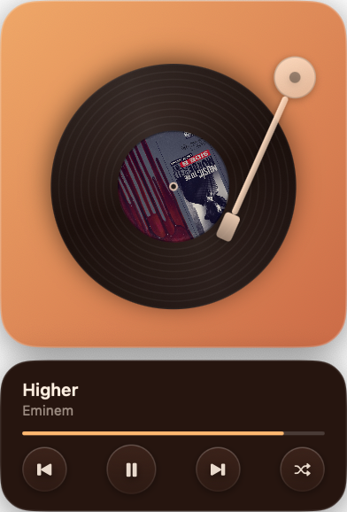
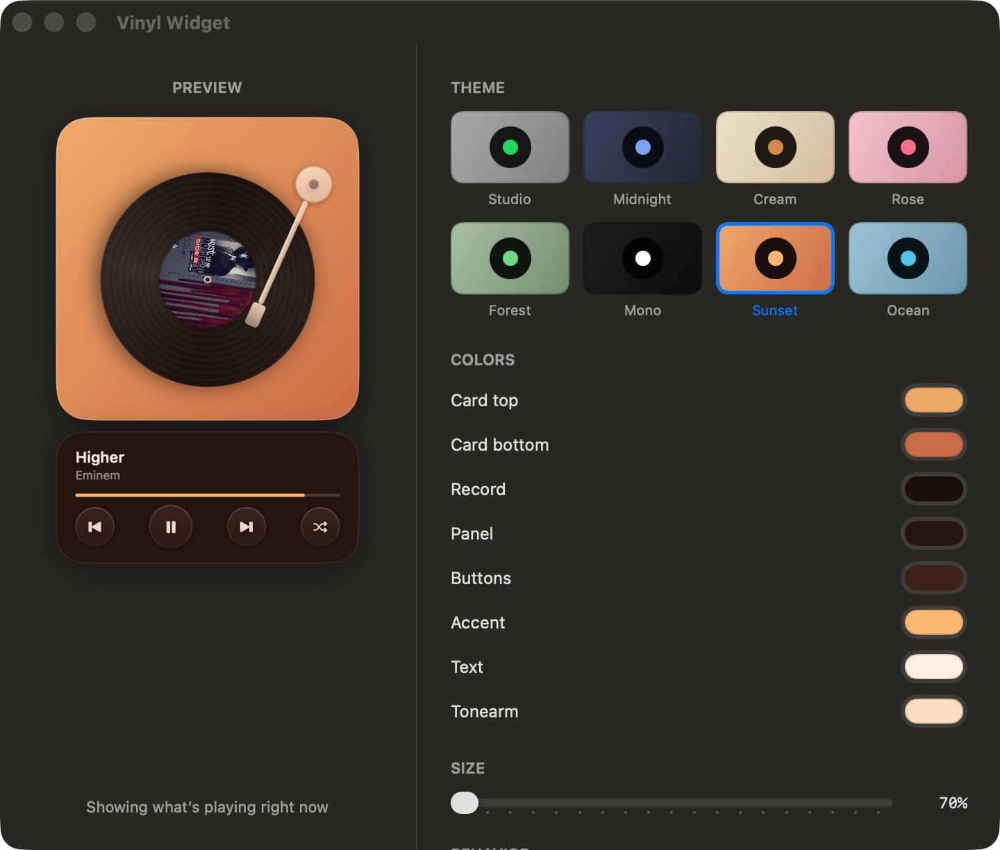

# Vinyl Widget

A spinning record on your Mac desktop that plays along with Spotify. The album art is
the label, the tonearm drops when music starts and tracks inward as the song runs, and
the whole thing can sit **on your wallpaper**, behind every window.

<p align="center">
  
</p>

It talks to the **Spotify desktop app** directly through Apple Events — no Spotify login,
no API key, no developer account, nothing to sign up for.

---

## Install

You need **macOS 13 (Ventura) or newer** and the Spotify desktop app.

```bash
git clone https://github.com/YOUR-USERNAME/vinyl-widget.git
cd vinyl-widget
./install.sh
```

That's it. The script checks your macOS version, builds the app, installs it to
`/Applications`, and launches it.

The first time you run it, macOS asks **"VinylWidget wants access to control Spotify."**
Click **Allow** — the widget can't read what's playing without it.

<details>
<summary>Don't have Apple's developer tools?</summary>

`install.sh` will tell you and open the installer for you. It's a one-time ~1GB download
from Apple. Let it finish, then run `./install.sh` again.
</details>

<details>
<summary>Downloaded a release .zip instead?</summary>

Because this app isn't notarized by Apple, macOS blocks it on first open. Right-click
`VinylWidget.app` → **Open** → **Open**. Or run:

```bash
xattr -dr com.apple.quarantine /Applications/VinylWidget.app
```
</details>

---

## Make it yours

Click the **⏺ disc icon in your menu bar → Customize…** (or hover the widget and click
the slider button in its corner).

<p align="center">
  
</p>

* **8 built-in themes** — Studio, Midnight, Cream, Rose, Forest, Mono, Sunset, Ocean.
* **Every colour is yours** — card, record, panel, buttons, accent, text, tonearm. Pick
  any colour and the widget updates live.
* **Size** — 70% to 160%.
* **Sit on the wallpaper** — the widget drops behind all your windows and lives on the
  desktop. Turn it off and it floats on top instead.
* **Spin, tonearm, control panel** — turn any of them off. Panel off leaves just the
  record.
* **Open at login.**

Themes are stored as plain hex in your preferences, so anything you build is easy to
share — copy the values out of `Sources/Theme.swift` to add your own preset.

---

## Using it

| Action | What happens |
| --- | --- |
| Click the record | play / pause |
| Drag the widget | move it (position is remembered) |
| Drag the thin bar | seek within the track |
| Knobs | previous, play/pause, next, shuffle |
| Right-click | Customize, Open Spotify, Quit |
| Hover | reveals the customize button |

---

## If something looks wrong

**I can't see the widget.** It's probably in wallpaper mode, behind your windows. Show
your desktop, or menu bar icon → uncheck *Sit on Wallpaper*.

**The buttons do nothing / it says "Allow Spotify control".** macOS is blocking Apple
Events. Open **System Settings → Privacy & Security → Automation → VinylWidget** and
switch **Spotify** on. Clicking the widget's message takes you there.

**It says Spotify isn't running** while Spotify clearly is. Same as above — that message
also appears when permission was denied.

**"Open at login" won't turn on.** Move the app to `/Applications` (the installer does
this) and try again; otherwise add it by hand in **System Settings → General → Login
Items**.

---

## How it works

`SpotifyController` runs small AppleScripts through `osascript` on a background queue to
read player state and send commands, and listens for Spotify's
`com.spotify.client.PlaybackStateChanged` distributed notification so it reacts the
instant you change tracks anywhere. Between syncs it advances the playhead locally, so
the progress bar is smooth without hammering Spotify.

The window is a borderless non-activating `NSPanel`. In wallpaper mode its level is set
just above the desktop-icon layer, which puts it under every ordinary window but above
the wallpaper.

### Two things that bite when editing the UI

1. **`NSHostingView` hosts SwiftUI in a y-up AppKit space**, so a positive
   `rotationEffect` reads as *counter-clockwise* on screen. The record spin and the
   tonearm angle are written in screen terms and negated at the call site.
2. **Give every row in the control panel an explicit height.** Without them the column
   lays out taller than its card, the overflow is centred, and the clip shape silently
   eats the title and the buttons — it looks like SwiftUI is refusing to draw them.

### Building by hand

```bash
./build.sh        # universal binary (Apple Silicon + Intel), ad-hoc signed
open VinylWidget.app
```

Source layout:

| File | What's in it |
| --- | --- |
| `Sources/main.swift` | panel, window level, menu bar item, settings window |
| `Sources/SpotifyController.swift` | Apple Events bridge and playback state |
| `Sources/WidgetView.swift` | turntable, tonearm, control panel |
| `Sources/SettingsView.swift` | the customizer |
| `Sources/Theme.swift` | colour model and the eight presets |
| `Sources/Settings.swift` | preferences and persistence |
| `make-icon.py` | regenerates `Resources/AppIcon.icns` (only if you change the art) |

---

## License

MIT — see [LICENSE](LICENSE).

Not affiliated with, endorsed by, or connected to Spotify AB. "Spotify" is a trademark
of Spotify AB.
